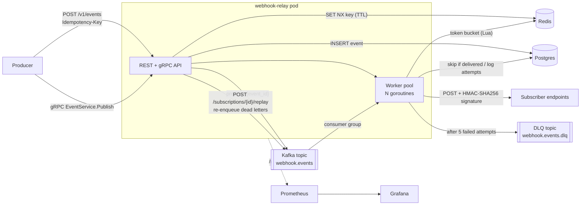

# webhook-relay

A webhook delivery service in Go, in the style of Stripe or GitHub webhooks. Producers publish events over REST or gRPC. The service stores each event, puts it on Kafka, and a pool of worker goroutines delivers it to every matching subscriber endpoint as a signed HTTP POST. Failed deliveries are retried with backoff, and deliveries that run out of retries go to a dead-letter queue that can be replayed.

**Stack:** Go · chi · pgx/Postgres · go-redis · franz-go/Kafka (Redpanda locally) · gRPC/protobuf (buf) · Prometheus/Grafana · Docker · Kubernetes · Terraform (AWS) · testcontainers-go · k6

## Architecture



### Publish path
1. `SET idem:<key> <new-id> NX EX 24h` in Redis. If the key already exists, return the original event ID with `duplicate: true` and stop.
2. `INSERT` the event into Postgres. A unique partial index on `idempotency_key` is a durable backstop for when the Redis key has expired or Redis lost data.
3. Produce `{event_id}` to Kafka, keyed by event ID, with `acks=all`. Return `202`.

The row is written before the message exists, so a worker never sees an event it can't load. If the produce fails, the client gets a 5xx and retries with the same key. That retry finds the existing row and enqueues it again.

### Delivery path
- The consumer polls a batch, sends it to `WORKERS` goroutines, and **commits offsets only after every record in the batch is handled**. A crash at any point therefore leads to redelivery, not loss.
- For each `(event, subscription)` pair, the worker first checks for an existing `succeeded` row and skips the pair if one exists. This is what makes Kafka redelivery safe.
- Each attempt takes a token from the subscriber's Redis token bucket (an atomic Lua script, shared across pods), then POSTs with these headers:
  - `Webhook-Id`: the event ID, which subscribers use for dedupe
  - `Webhook-Timestamp`
  - `Webhook-Signature: v1=hex(HMAC-SHA256(secret, "<ts>.<body>"))`
- A non-2xx response or a network error is retried with exponential backoff and **full jitter** (`rand[0, min(max, base·2^n)]`). After `MAX_ATTEMPTS` (default 5), the attempt is recorded as `dead` and published to the DLQ topic.
- `POST /v1/subscriptions/{id}/replay` re-enqueues every dead event for that subscriber that was never delivered afterwards.

### Graceful shutdown
On SIGTERM, the service stops accepting HTTP and gRPC requests and stops polling Kafka. HTTP requests already in flight to subscribers can finish, up to `SHUTDOWN_TIMEOUT`. A worker sleeping in backoff doesn't wait the sleep out: it abandons the record. Any batch with an abandoned record is **not committed**, so the next consumer picks it up. `terminationGracePeriodSeconds` (k8s) and `stopTimeout` (ECS) are set longer than the drain timeout.

## Design decisions

**At-least-once delivery plus idempotency, rather than exactly-once.** Exactly-once delivery to an arbitrary HTTP endpoint is impossible. If the subscriber returns 200 and the worker dies before recording it, no protocol can tell whether the POST took effect. Kafka transactions only cover Kafka-to-Kafka, not side effects over HTTP. So the system:
- guarantees **no loss**: offsets are committed after handling, and the event is persisted before it is enqueued
- makes duplicates **rare and detectable**: a delivered-check before each send, a unique index on successes, and a stable `Webhook-Id` so subscribers can dedupe
- makes duplicate **publishes** harmless: Redis `SET NX` plus a unique index in Postgres

The window for a duplicate is "the subscriber returned 2xx, but the success row wasn't written yet". The chaos test measures how often that happens.

**Why Kafka and Postgres both?** Postgres is the source of truth and the audit log of every attempt. Kafka provides partitioned, replayable work distribution and consumer-group rebalancing without making Postgres act as a queue (no `SELECT … FOR UPDATE SKIP LOCKED` hot spot). Messages carry only IDs, so Kafka holds no PII and payload size never affects it.

**Retries in-process rather than via a retry topic.** This is simpler, and backoff is capped at 30s. The cost is that a worker slot is tied up while it waits. At higher scale you would switch to delay topics (`retry-5s`, `retry-1m`, …) or a Postgres `next_attempt_at` scheduler.

**Fan-out happens at delivery time, not at publish time.** This keeps publishes O(1). The trade-off is that a subscription created after an event was published but before it was consumed will receive that event.

### Indexes

| Index | Query it serves |
|---|---|
| `subscriptions_event_types_gin` — GIN on `event_types`, partial `WHERE active` | Fan-out lookup `event_types && ARRAY[$type,'*']`. GIN is the index type that supports array overlap. The partial index excludes deactivated subscriptions. |
| `events_idempotency_key_uniq` — unique, partial `WHERE key IS NOT NULL` | Durable idempotency (`ON CONFLICT DO NOTHING`). Partial so that events without a key don't fill it. |
| `delivery_attempts_one_success` — unique `(event_id, subscription_id) WHERE status='succeeded'` | The worker's "already delivered?" check before each send, and a hard guarantee of at most one recorded success per pair. |
| `delivery_attempts_sub_created` — `(subscription_id, created_at DESC)` | `GET /subscriptions/{id}/deliveries`, newest first, with no sort step. |
| `delivery_attempts_dead` — `(subscription_id, event_id) WHERE status='dead'` | `/replay` finds dead letters without scanning the far larger set of successes. |

## API

```bash
# create a subscription (the secret is returned only once)
curl -XPOST localhost:8080/v1/subscriptions -d '{"url":"http://receiver:8090/hook","event_types":["order.created"],"rate_limit_per_sec":100}'

# publish
curl -XPOST localhost:8080/v1/events -H 'Idempotency-Key: order-42' -d '{"event_type":"order.created","payload":{"id":42}}'

curl localhost:8080/v1/subscriptions/<id>/deliveries
curl -XPOST localhost:8080/v1/subscriptions/<id>/replay

# gRPC (reflection is not enabled; pass the proto)
grpcurl -plaintext -import-path proto -proto webhook/v1/webhook.proto \
  -d '{"event_type":"order.created","payload_json":"eyJpZCI6NDJ9"}' localhost:9090 webhook.v1.EventService/Publish
```

### Verifying a signature (subscriber side)
```go
ok := signing.Verify(secret, r.Header.Get("Webhook-Signature"), ts, body, time.Now(), 5*time.Minute)
```
`cmd/receiver` is a complete example subscriber. It verifies signatures, counts unique and duplicate deliveries, and can be told to fail (`FAIL_RATE`, `POST /toggle`).

## Observability
Metrics are served at `/metrics`:

| Metric | Type |
|---|---|
| `webhook_deliveries_total{status=succeeded\|failed\|dead\|duplicate}` | counter |
| `webhook_delivery_duration_seconds` | histogram, per attempt |
| `webhook_end_to_end_seconds` | histogram, publish to success |
| `webhook_queue_lag_seconds` | histogram |
| `webhook_retries_total` | counter |
| `webhook_rate_limited_total` | counter |
| `webhook_dead_lettered_total` | counter |
| `webhook_publish_duration_seconds{transport}` | histogram |

The Grafana dashboard is in [`deploy/grafana/dashboards/webhook-relay.json`](deploy/grafana/dashboards/webhook-relay.json) and is auto-provisioned by compose. Logs are structured JSON (`log/slog`), and every HTTP log line carries `request_id`.

## Running

```bash
make up                  # Postgres, Redis, Redpanda, service, receiver, Prometheus (:9091), Grafana (:3000)
make test                # unit tests (table-driven)
make integration         # testcontainers: real Postgres/Redis/Redpanda, incl. chaos test
make loadtest RATE=1000  # k6
make outage              # subscriber-down → DLQ growth → replay
make proto               # regenerate gRPC code with buf
```

Kubernetes: `kubectl apply -k deploy/k8s` (Deployment, Service, HPA, ConfigMap, Secret).
AWS: `cd terraform && terraform apply -var image=…` provisions a VPC, ECS Fargate behind an ALB, RDS Postgres, ElastiCache Redis, and optionally MSK Serverless (`enable_msk`). **Run `terraform destroy` afterwards.** The NAT gateway, RDS and ALB bill by the hour.

## Tests
- **Unit:** signature verification (tamper, wrong secret, stale timestamp), backoff ceilings and jitter bounds, and worker retry → success / retry → DLQ / redelivery skip / shutdown aborting a backoff. Uses `httptest` subscribers.
- **Integration** (`-tags integration`, testcontainers):
  - publish → deliver, with a duplicate `Idempotency-Key` delivered exactly once and a valid signature
  - subscriber down → 5 dead letters → replay → all delivered and the DLQ emptied
- **Chaos:** publish 200 events to a slow subscriber, hard-kill the consumer mid-batch (in-flight requests cancelled, offsets uncommitted), start a new consumer. The test asserts **all 200 delivered (no loss)** and reports the duplicate count, which is bounded by the in-flight slots.
- **CI:** `make ci` ([`scripts/ci.sh`](scripts/ci.sh)) runs gofmt, `go vet`, golangci-lint, `go test -race` and govulncheck. When Docker and terraform are available, it also runs the integration/chaos tests, the docker build and `terraform validate`. The same checks are defined for GitHub Actions in [`.github/workflows/ci.yml`](.github/workflows/ci.yml), but Actions is currently disabled on this repo, so run `make ci` before pushing.

## Results

> Not measured yet. Fill this in from `make loadtest`, `make outage` and the chaos test log.

| Metric | Value |
|---|---|
| Sustained publish throughput | _TBD_ events/s |
| Publish latency p50 / p99 | _TBD_ / _TBD_ ms |
| End-to-end delivery p50 / p99 | _TBD_ / _TBD_ ms |
| Chaos test: lost / duplicated | _TBD_ / _TBD_ of 200 |
| Outage: DLQ peak → after replay | _TBD_ → 0 |

Hardware: _TBD_
